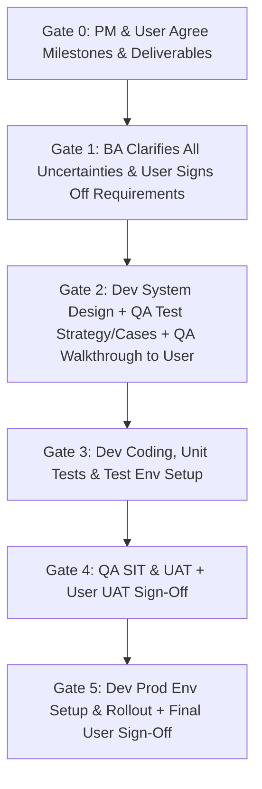

# Team Workflow, RACI & Governance

## 1. Roles & Responsibilities (RACI Matrix)

| Activity | User (Sponsor) | PM | BA | Dev | QA |
|---|:---:|:---:|:---:|:---:|:---:|
| Agree Milestones & Deliverables | **A / C** | **R** | C | C | C |
| Elicit & Clarify Requirements | **A / C** | I | **R** | I | I |
| Sign Off Requirements Baseline | **A / R** | C | C | I | I |
| System Design & Architecture | I | A | C | **R** | C |
| Test Strategy, Plan & Test Cases | C | A | C | I | **R** |
| QA Test Case & Coverage Walkthrough | **A / C** | C | I | I | **R** |
| Coding & Unit Testing | I | A | I | **R** | I |
| Test Environment Setup | I | A | I | **R** | C |
| SIT Execution & Defect Triage | I | A | C | C | **R** |
| UAT Execution & Sign-Off | **A / R** | C | C | C | **R** |
| Production Setup & Rollout | **A** | C | I | **R** | C |

*Legend: **R** = Responsible, **A** = Accountable, **C** = Consulted, **I** = Informed*

## 2. Stage-Gate Flow

## 3. PM Delivery Enforcement & Conflict Resolution

The Project Manager enforces delivery across BA, Dev, and QA using:
1. **Strict Gate Entry/Exit Criteria**: No agent may start downstream work on unapproved upstream artifacts.
2. **Rejection of Incomplete Handoffs**:
   - BA cannot hand off requirements with `OPEN` uncertainties.
   - Dev cannot hand off to QA without passing unit tests and a ready Test Environment.
   - QA cannot approve rollout without passing SIT/UAT and User sign-off.
3. **Proactive Escalation with Solutions**: Whenever a blocker or resource conflict occurs, PM documents options + a recommended solution in `docs/pm/risks-and-issues.md` and presents it to the User.

## 4. Autonomous `AGENTS.md` Self-Improvement

Whenever any agent discovers a better collaboration pattern, checklist, or handoff protocol, they update `AGENTS.md` directly without asking the User and record the change in its `Change Log`.

